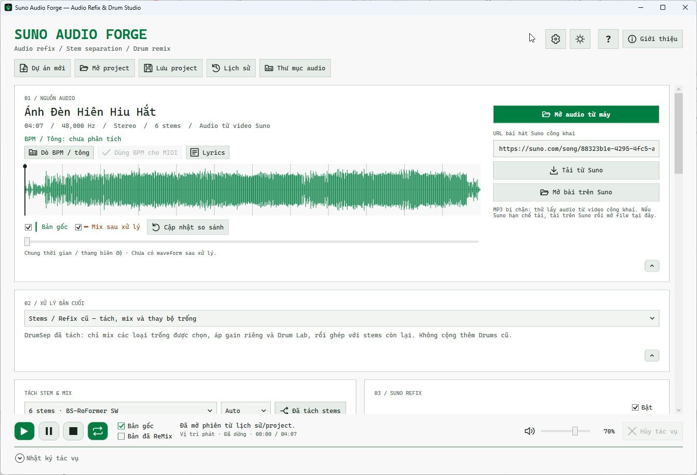
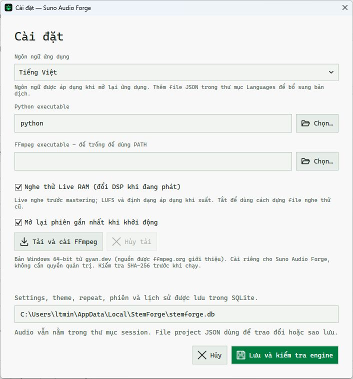
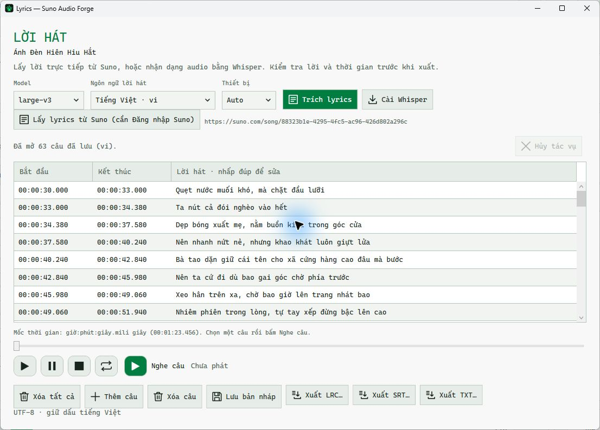
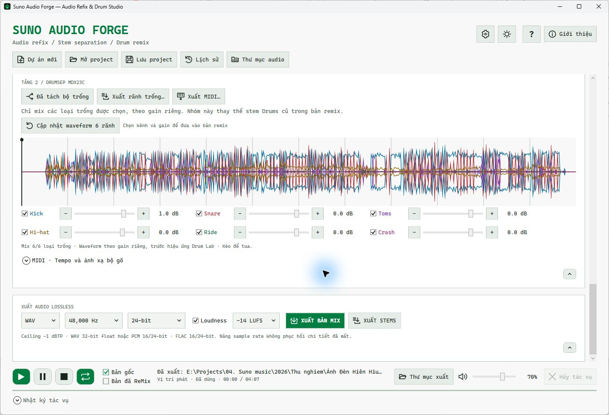

# Suno Audio Forge — Audio Refix & Drum Studio

Ứng dụng Windows của **HAY Studio73** để tách nhạc cụ, chỉnh từng kênh trống, nghe Live Remix trong RAM, sửa lyrics và xuất WAV/FLAC. Giao diện Tiếng Việt / English; xử lý audio cục bộ.

**[DOWNLOAD APP Windows](apps/SunoAudioForge-v0.15.0.zip)** · [Hướng dẫn Tiếng Việt](docs/Huong-dan-tach-Stems.html) · [English guide](docs/Stem-Separation-Guide.en.html)

**Check AV: https://www.scanrepo.dev/**

**hoặc VirusTotal checked**


# Quick Install

1. Giải nén ZIP
2. Cài thư viện python và FFmpeg:
Mở PowerShell tại thư mục chứa SunoAudioForge.exe vừa giãn nén, chạy lệnh:

```powershell -NoProfile -File scripts/setup-engine.ps1 -Python python -Device cpu```

4. Click chạy `SunoAudioForge.exe`.
 
**Cần .NET 10 Desktop Runtime, Python/engine audio và FFmpeg; xem thêm phần cấu hình/cài đặt bên dưới. Các Model tách nhạc tải riêng, không nằm trong bản ZIP này.**
**Chú ý: Đây là ứng dụng công cụ hỗ trợ độc lập, không phải sản phẩm chính thức của Suno.**

Mã nguồn ở folder `src/StemForge`, engine ở `engine`, kiểm thử ở `tests`. 

## Screenshot ứng dụng

Ảnh chụp trực tiếp Suno Audio Forge 0.15.0 trên Windows, ngày 26/10/2026

| Main · Nguồn audio và remix | Settings · Live RAM và engine |
| --- | --- |
|  |  |

| Lyrics · Lời hát và mốc thời gian | Export completed · Xuất bản mix thành công |
| --- | --- |
|  |  |

**Chú ý: hãy nhấn nút cài Engine Roformer/DrumSep trước khi tách Stems trống!**


## Phiên bản 0.15.0 — Nghe remix trực tiếp trong RAM

**Bật mặc định:** chọn **Bản đã ReMix**, bấm Play, rồi chỉnh EQ, Stereo DSP, Drum Lab, gain, Mute/Solo hoặc các kênh DrumSep. Thay đổi được xử lý theo từng khối PCM trong bộ nhớ và đưa vào luồng phát WASAPI; không dựng WAV nghe thử cho mỗi lần chỉnh. Bản gốc, stem riêng, tua, tạm dừng và lặp dùng chung bộ phát. Chuyển A/B giữ vị trí và trạng thái phát.

- **Settings → Nghe thử Live RAM**
- Worker Python giữ chạy và tái sử dụng cache PCM có giới hạn **256 MiB**. Đây là giới hạn cache, không phải toàn bộ RAM ứng dụng/Python. DSP nghe thử chạy trên **CPU**; GPU/VRAM vẫn dùng cho tách mô hình nếu đã chọn CUDA.
- Nghe live ở **48 kHz, float32 stereo**, khối 200 ms, crossfade tham số 20 ms. Độ trễ gồm thời gian tính toán và hàng đợi âm thanh, không phải zero latency. Khi thiếu dữ liệu, bộ phát chèn im lặng và không bỏ qua vị trí âm nhạc.
- **XUẤT BẢN MIX / XUẤT STEMS** vẫn xử lý file đầy đủ bằng thông số hiện tại, sample rate/bit depth đã chọn và mastering LUFS/true peak nếu bật. Không xuất lại dữ liệu nghe thử từ cache.
- Live là nghe thử **trước mastering**: không cân LUFS với bản gốc, vì vậy bản xuất có thể khác độ lớn. Nhánh Sub/trigger phân tích ngữ cảnh ngắn khi nghe live nên việc bắt hit có thể khác phân tích toàn bài; không cam kết bit-identical với file xuất. EQ, Structural và Drum Lab dùng chung lõi DSP với export.
- **Cập nhật so sánh** tính waveform trước mastering trong RAM theo yêu cầu; waveform không tự tính lại toàn bài khi kéo slider.

## Phiên bản 0.14.2 — Lyrics theo timeline và kiểm thử CPU

- Chỉ giữ nút **Lấy lyrics từ Suno (cần Đăng nhập Suno)**
- Khi phát, tua hoặc lặp, tự chọn và cuộn đến dòng có mốc thời gian phù hợp, tô nền xanh dương/chữ trắng ở cả hai theme. Khoảng nghỉ không chọn dòng; bỏ qua thời gian lỗi/trống. Không chuyển hàng khi người dùng đang sửa ô.
- **Xóa tất cả** có icon, dừng nghe và xóa toàn bộ dòng trong trình sửa. Bấm Lưu bản nháp hoặc đóng cửa sổ để lưu danh sách rỗng vào SQLite; file audio không bị xóa.
- Kiểm thử CPU-only trên đoạn nhạc thật **36 giây**, chạy suy luận mới: BS-RoFormer SW 6 stems **211,15 giây**, DrumSep MDX23C 6 loại trống **147,56 giây**, tổng hai tầng khoảng **5 phút 59 giây**. CUDA bị ẩn và cả hai kết quả báo `device=cpu`. Đầu ra đủ 12 file stereo 44,1 kHz, cùng độ dài, hữu hạn. Đây là thời gian của đoạn thử trên máy này, không phải đo toàn bài hoặc đánh giá chất lượng SDR.

## Phiên bản 0.14.1 — Lấy mốc thời gian lyrics bằng phiên Suno

Trong **Lyrics**, bấm **Lấy timing · Đăng nhập Suno** → đăng nhập trong cửa sổ Suno của ứng dụng → bấm **Lấy mốc thời gian**. App gọi API aligned lyrics cho đúng bài đang mở, giữ timing theo từ/câu mà Suno trả về, đưa về trình sửa lyrics để nghe, sửa và xuất LRC/SRT UTF-8. Không chạy Whisper và không tự chia thời gian theo số dòng.

Trình duyệt WebView2 dùng profile riêng `%LOCALAPPDATA%/StemForge/SunoBrowser`, không đọc phiên Chrome/Edge có sẵn. Token chỉ dùng trong trang Suno để gửi đến API Suno, không đưa vào engine Python, log, project hay SQLite. Có nút **Xóa phiên đăng nhập**. Một số nhà cung cấp đăng nhập có thể hạn chế trình duyệt nhúng; nếu không đăng nhập được, vẫn dùng chức năng lấy lời công khai/Whisper hiện có. Không bảo đảm mọi bài Suno có dữ liệu alignment.

## Phiên bản 0.14.0 — Lyrics trực tiếp từ Suno

- Mở **Lyrics** ngay trong Nguồn audio, hoặc trên stem Vocals. Bài tải từ URL Suno có nút **Lấy lời từ Suno**
- Nếu Suno chỉ trả phần lời (API timing có thể yêu cầu đăng nhập), các ô thời gian để trống. Có thể sửa, lưu bản nháp và xuất **TXT UTF-8** ngay; nghe audio, điền Bắt đầu/Kết thúc rồi xuất **LRC/SRT**. 
- Sau khi xuất thành công mix, stems, DrumSep, MIDI hoặc lyrics, nút **Thư mục xuất** hiện ở thanh dưới và mở đúng thư mục kết quả mới nhất. Nút chưa hiện khi chưa có kết quả; hủy/lỗi không ghi đè đường dẫn xuất thành công trước đó.
## 0.13.2 — Âm lượng nghe

## 0.13.1 — Tạm dừng Chồng / Thay Sample trong  DrumSep

## 0.13.0 — Suno Audio Forge

Ứng dụng Windows native bằng **C# / WPF / .NET 10**, có solution Visual Studio. Engine audio chạy cục bộ bằng Python, Meta Demucs và FFmpeg. Phiên bản hiện tại: **0.15.0**.
## Cấu hình cơ bản và chạy lần đầu

Bản ZIP là ứng dụng Windows x64 dạng thư mục, chưa có bộ cài. Giải nén toàn bộ rồi chạy **SunoAudioForge.exe**; giữ nguyên các thư mục `engine`, `Languages` và DLL đi kèm.

| Thành phần | Yêu cầu / khuyến nghị |
| --- | --- |
| Hệ điều hành | Windows 11 x64; không hỗ trợ Windows 7/8 hoặc Windows ARM trong gói x64 này |
| Giao diện | **.NET Desktop Runtime 10 x64** |
| Engine | Python **3.12 hoặc 3.13 x64**, FFmpeg và các package trong `engine/requirements.txt` |
| CPU / RAM | Điểm khởi đầu đề xuất: CPU x64 4 nhân, RAM 8 GB cho stereo; 16 GB trở lên cho tách stems, 32 GB nên dùng cho bài dài / 6 stems |
| GPU | Không bắt buộc: có chế độ CPU. **NVIDIA CUDA với VRAM 8 GB** trở lên là khuyến nghị tăng tốc, không bảo đảm đủ cho mọi model/độ dài; nếu thiếu VRAM chọn CPU |
| Ổ đĩa | Nên có ít nhất 20 GB trống cho môi trường Python, model và vài phiên audio; nhiều bài/stems cần thêm dung lượng, ưu tiên SSD |
| Kết nối mạng | Cần khi cài engine, tải model lần đầu hoặc tải bài Suno; xử lý file/model đã có diễn ra trên máy |

Các mức CPU/RAM/VRAM/ổ đĩa trên là **khuyến nghị khởi đầu**, chưa phải cấu hình tối thiểu được benchmark. Tài nguyên thực phụ thuộc model, độ dài audio và số kênh. Gói ZIP không kèm Python, FFmpeg, .NET Runtime hoặc checkpoint. Xem [hướng dẫn .NET trên Windows của Microsoft](https://learn.microsoft.com/en-us/dotnet/core/install/windows) và [Demucs: yêu cầu bộ nhớ GPU](https://github.com/facebookresearch/demucs#memory-requirements-for-gpu-acceleration).

1. Cài .NET Desktop Runtime 10 x64 và Python x64. Trong thư mục đã giải nén (hoặc thư mục mã nguồn), chạy 

```
powershell -NoProfile -File scripts/setup-engine.ps1 -Python python -Device cpu
```

để tạo `.venv` và cài engine. Script đi kèm gói ZIP; có hướng dẫn CUDA ở mục bên dưới.
3. Mở **Cài đặt**, chọn đúng `python.exe` của môi trường engine. Chọn FFmpeg có sẵn hoặc bấm **Tải và cài FFmpeg**. Bấm **Lưu và kiểm tra engine**.
4. Mở audio. Nếu cần tách hai tầng, dùng nút **Cài engine RoFormer / DrumSep** rồi tải model ở lần tách đầu. Lyrics dùng model có nút cài Whisper riêng.
5. Mở **? / F1** để đọc hướng dẫn. Ngôn ngữ mặc định là Tiếng Việt; chọn English trong Cài đặt, lưu và mở lại ứng dụng. Cách thêm ngôn ngữ: [Languages/README.md](src/StemForge/Languages/README.md).

## Giải thích thông số Drum Lab (0.8)

Mở **Giải thích 12 thông số gợi ý** để xem đầy đủ giá trị, tác dụng và giới hạn của cấu hình đang chọn. Bảng này là phần xem trước của preset; các thanh chỉnh chỉ đổi khi bấm **Áp dụng**. Di chuột trên mỗi thanh chỉnh hoặc hộp chế độ để đọc giải thích tương ứng.

Thêm **Rap / Hip-hop · theo ảnh** và **Jazz · theo ảnh / hit rõ**, đúng các giá trị ảnh tham khảo. Cấu hình **Acoustic / Jazz · tiếng nhỏ** vẫn có sẵn để ưu tiên ghost note/roll. Đây là điểm khởi đầu, chưa phải phân tích tự động hay kiểm chứng chất lượng trên bài hát của bạn.

| Thông số | Rap theo ảnh | Jazz theo ảnh | Acoustic / Jazz · tiếng nhỏ |
| --- | --- | --- | --- |
| Transient / Multiband / Parallel | 55 / 25 / 40% | 25 / 10 / 15% | 5 / 5 / 10% |
| Mức sample / Độ nhạy | 50 / 55% | 25 / 35% | 15 / 75% |
| Ngưỡng / Chống lặp | −42 dBFS / 70 ms | −36 dBFS / 120 ms | −56 dBFS / 40 ms |
| Lọc bắt chéo / Giữ lực | 5 / 90% | 15 / 100% | 0 / 100% |
| Chế độ sample | Round robin | Round robin | Theo lực |

Cả ba dùng Studio và chồng giữ nguyên nền. Những điểm cần nghe lại:

- **Jazz:** −36 dBFS là ngưỡng cao hơn −42 dBFS, nên loại nhiều tiếng nhỏ hơn. Độ nhạy 35% còn loại onset yếu tương đối. Giữ lực 100% chỉ giữ tương quan các hit còn lại, không khôi phục hit đã bỏ sót.
- **Roll/hi-hat nhanh:** ở 120 BPM, nốt 1/32 cách nhau 62,5 ms. Chống lặp 70 hoặc 120 ms có thể bỏ hit cùng rãnh; thử 30–45 ms và kiểm tra bắt lặp. Không có ngưỡng chung tối ưu cho mọi nhạc phẩm.
- **Transient:** tác động cả cymbal và sample đã chồng. 55% có thể nâng đầu tiếng tối đa theo công thức hiện tại khoảng 6,4 dB trước các bước nén; không có nghĩa là toàn bài tăng 55% âm lượng. Với trap hi-hat sắc, thử 40–50% hoặc thấp hơn.
- **Multiband / Parallel:** là dry/wet của các bước nén nối tiếp, không phải ratio. Multiband dùng mốc 180 Hz và 4 kHz, ngưỡng −24 dB, ratio 3:1; Parallel dùng −28 dB, 8:1, bù +6 dB.
- **Layer 50%:** nền giữ nguyên cộng sample × 0,5 × lực hit. Thay thế mới giảm toàn nền theo tỷ lệ; không xóa chọn lọc từng nhạc cụ. Nghe kick để kiểm tra tương tác phase với sample mới. Routing stems không cộng thêm bản gốc toàn dải.
- **Lọc bắt chéo:** chỉ dùng khi bắt hit theo dải tần. Với rãnh DrumSep hợp lệ, engine luôn dùng mức hiệu lực 0% để không loại các hit đồng thời trên rãnh khác nhau.
- **Round robin:** cần nhiều file để luân phiên. Sample theo lực cần sắp file nhẹ → mạnh. Kit tích hợp là tổng hợp, không phải trống thu thật.

Các nút Reset / Punch / Tight / Layer, Áp dụng / Lưu mặc định / Bỏ mặc định, chọn / xóa sample và Tách bộ trống có icon vector kèm nhãn, theo màu giao diện. Nút sample giữ định danh nhạc cụ khi chọn file và khôi phục project.

## Gợi ý Drum Lab

Khung **GỢI Ý THEO THỂ LOẠI** nằm dưới Reset / Punch / Tight / Layer 45%. Có Trung tính, Ballad/Bolero, Pop/V-Pop, Acoustic/Jazz, Rock/Live, Dance/EDM và Hip-hop/R&B. Các cấu hình là điểm khởi đầu do Suno Audio Forge thiết kế, không phải kết quả tự phân tích bài hát hay thông số chuẩn của một thể loại.

- Chọn thể loại để xem mô tả và thông số; bấm **Áp dụng** mới thay đổi hiệu ứng, trigger, mức sample, kit và chế độ chồng sample. Các sample riêng, stems và MIDI mapping đang dùng được giữ.
- Chỉnh thêm rồi bấm **Lưu lại thông số…**, đặt tên riêng (1–80 ký tự, không trùng). Chọn lại và bấm nút **Áp dụng**. Có thể đánh dấu dùng làm mặc định cho bài mới; sample riêng và MIDI không thuộc bộ thông số.
- **Bỏ mặc định riêng** đưa bài nhập mới về Drum Lab trung tính; không đổi bài đang mở. Mở lại project/lịch sử luôn khôi phục các thông số của project, không ghi đè bằng mặc định mới. Mặc định không chứa đường dẫn sample, audio hoặc MIDI mapping.

## Tách hai bước và MIDI trống (0.6)

1. Chọn **Stems / Refix cũ** để mở mixer và Drum Lab. PA1 vẫn là mặc định khi nhập bài mới.
2. Bấm **Cài engine RoFormer / DrumSep** nếu Python đang chọn chưa có `audio-separator==0.47.0`. Bấm **Tách hai bước SW → DrumSep**: SW tạo Bass/Drums/Other/Vocals/Guitar/Piano; chỉ stem Drums đi vào MDX23C để tạo Kick/Snare/Toms/Hi-hat/Ride/Crash. Có sẵn stem Drums từ Demucs thì bấm **Tách bộ trống** để chạy riêng tầng 2.
3. Model tải lần đầu khoảng 1,1 GB, kiểm SHA-256 theo phiên bản cố định, lưu tại `%LOCALAPPDATA%/StemForge/Models`. Auto ưu tiên CUDA; có thể chọn CPU. Audio không gửi lên dịch vụ. Hủy/lỗi tầng 2 vẫn giữ kết quả tầng 1 đã hoàn tất.
4. Chọn các rãnh đưa vào remix, nghe bằng thanh phát chung, **Xuất rãnh trống…** ra WAV/FLAC theo định dạng đã chọn hoặc **Xuất MIDI…**. MIDI kênh 10, mặc định GM Kick 36 / Snare 38 / Toms 45 / Hi-hat 42 / Ride 51 / Crash 49. Có thể sửa từng note và BPM. BPM đặt lưới DAW, không đổi thời điểm hit; không tự dò tempo, không quantize.

Trigger dùng ngưỡng transient trên từng rãnh DrumSep và giữ tương quan lực đánh, không dò cao độ giai điệu. Hit đồng thời trên các rãnh độc lập không bị bộ lọc bắt chéo loại bỏ. Toms dùng một note chung; Hi-hat chưa phân biệt mở/đóng. Có thể điều chỉnh ngưỡng, độ nhạy và chống lặp hit trước khi xuất lại MIDI. Việc tách nhầm/bleed có thể tạo hit sai; chưa có trình sửa từng hit. Sample có khoảng lặng đầu file cần được cắt trước; chưa có tự căn phase giữa sample mới và trống nền.

**Routing:** chỉ cộng các stem SW/Demucs độc lập, với Drums đã xử lý một lần. Các rãnh DrumSep là nguồn bắt hit/nghe/xuất, không cộng chồng lần nữa vào mix. Giữ gain tương đối của đầu ra model, không peak-normalize từng stem. Đầu ra mô hình học máy không được giả định cộng lại chính xác tuyệt đối thành bản gốc. Đường dẫn rãnh con, parent Drums, mode layer, sample banks và mapping MIDI lưu trong SQLite và project JSON.

Model SW dùng [BS-ROFO-SW-Fixed](https://huggingface.co/enerjazzer/BS-ROFO-SW-Fixed); DrumSep dùng checkpoint **MDX23C-DrumSep-aufr33-jarredou** được liệt kê trong [MSST pretrained models](https://github.com/ZFTurbo/Music-Source-Separation-Training/blob/main/docs/pretrained_models.md), tải từ bản mirror cố định. Link [Mel-Band Roformer Vocal Model](https://github.com/KimberleyJensen/Mel-Band-Roformer-Vocal-Model) là model vocals/instrumental, không dùng để gắn nhãn DrumSep. Chi tiết nguồn/checksum trong `engine/model_pipeline.py` và notices. Không kèm checkpoint trong ZIP ứng dụng.

Kiểm thử vận hành: clip Suno thật 36 giây đi qua cả hai tầng trên CUDA, 12 file stereo 44.1 kHz khớp số frame, MIDI percussion và mix FLAC 24-bit 48 kHz. Đây không phải benchmark SDR hoặc kiểm chứng trên 150 bài, cũng chưa phải đánh giá chất lượng bằng nghe. Tái chạy: `python scripts/smoke_cascade.py <audio>`; model tải nếu chưa có trong cache kiểm thử.

## Điều khiển phát và cài FFmpeg

Các nút phát, tạm dừng, dừng và lặp lại dùng icon vector bo góc. Di chuột để xem chức năng; nút lặp sáng xanh khi bật. Trạng thái lặp trong cửa sổ chính vẫn dùng chung và lưu SQLite; lặp trong cửa sổ lyrics áp dụng riêng cho Vocals hoặc câu đang nghe.

Trong **Settings → Tải và cài FFmpeg**, app tải bản Windows 64-bit release essentials từ [gyan.dev](https://www.gyan.dev/ffmpeg/builds/), nguồn được [ffmpeg.org giới thiệu](https://ffmpeg.org/download.html). Có tiến trình và Hủy tải. Sau khi kiểm tra SHA-256, giải nén và chạy `ffmpeg -version`, đường dẫn được điền tự động. Bấm **Lưu và kiểm tra engine** để áp dụng. FFmpeg nằm trong `%LOCALAPPDATA%/StemForge/Tools`, không sửa PATH và không cần admin. Khi lỗi/hủy, cấu hình cũ được giữ nguyên; bộ cài giữ các file license/readme của gói tải. Kết nối Internet cần thiết để tải.

## Trích lyrics từ Vocals

1. Chọn **Stems / Refix cũ**, tách stems, rồi bấm **Lyrics…** trên hàng **vocals**.
2. Chọn model Whisper (mặc định small), **Tự nhận diện** hoặc **Tiếng Việt**/ngôn ngữ khác, thiết bị Auto/CPU/CUDA. Auto ưu tiên GPU nếu khả dụng. Nếu Python chưa có Whisper, bấm **Cài Whisper**; thư viện `openai-whisper==20250625` được cài vào Python đang chọn trong Settings. Model tải từ nguồn Whisper khi chưa có trong cache; small cần nhiều dung lượng hơn base/tiny.
3. Bấm **Trích lyrics**. Nhận dạng chạy trên máy, giữ nguyên ngôn ngữ, không dịch sang tiếng Anh. Khi hoàn tất, kết quả có thời gian bắt đầu/kết thúc từng câu. Có thể hủy tác vụ; bản lời hiện tại được giữ nếu việc trích mới chưa hoàn tất.
4. Nhấp đúp ô để sửa lời hoặc thời gian dạng `00:01:23.456`; thêm/xóa câu nếu cần. Nút phát bên trái nghe Vocals từ vị trí hiện tại; nút xanh **Nghe câu** phát câu đang chọn. Bật lặp để nghe lại câu; kéo thanh vị trí để chuyển sang nghe liên tục.
5. **Lưu bản nháp** lưu trong SQLite, đóng cửa sổ cũng lưu các sửa đổi. Project JSON chứa bản lời đã lưu. Sau khi tách lại/thay file Vocals, bản lời cũ không được tự gắn vào audio mới.
6. **Xuất LRC… / Xuất SRT…** dùng UTF-8 có BOM, giữ dấu tiếng Việt, sắp xếp theo mốc bắt đầu. Thời gian sai hoặc kết thúc vượt audio sẽ được báo trước khi xuất. Bản nháp vẫn cho giữ thời gian đang sửa chưa hợp lệ.

Whisper được thiết kế cho nhận dạng tiếng nói; lời hát kéo dài, hòa âm và tiếng nhạc lọt vào stem có thể làm sai lời hoặc thời gian. Các model nhỏ thường cần sửa nhiều hơn. Kết quả là bản nháp có mốc từng câu, không phải căn chỉnh karaoke từng từ. Xem [Whisper](https://github.com/openai/whisper) về model và ngôn ngữ hỗ trợ.

## So sánh waveform

Waveform **xanh** là bản gốc; đường biên **cam** là bản mix cuối sau xử lý. Bấm **Cập nhật so sánh** để dựng waveform mà không tự phát, hoặc **Phát bản mix cuối** để dựng và nghe. Xuất mix cũng cập nhật đường cam theo đúng file vừa xuất. Nghe riêng stems/trống không thay đường so sánh bản mix cuối.

Hai lớp dùng chung thời gian và thang biên độ (mốc 1 = 0 dBFS, mở rộng chung nếu nguồn vượt mức này), không tự phóng lớn từng bản. Đường cam lấy từ PCM thực tế sau loudness, bảo vệ peak, đổi sample rate và mã hóa WAV/FLAC. Đây là đường bao peak stereo gộp, không phải đồ thị phase.

Bật/tắt riêng **Bản gốc** và **Mix sau xử lý** ngay dưới waveform; lựa chọn lưu trong SQLite và không làm thay đổi âm thanh. Kéo waveform hoặc thanh vị trí để tua audio đang nghe, kể cả khi ẩn cả hai lớp. Khi đổi tham số hoặc mở project khác, đường cam cũ được xóa; bấm cập nhật để dựng lại.

## Mặc định mới: xử lý stereo không cần stems

Trong **Xử lý bản cuối**, chọn một trong ba chế độ:

| Chế độ | Nguồn được dùng | Xử lý |
|---|---|---|
| **PA1 · Transient / Tonal + Mid/Side** | Stereo gốc, một lần | Nâng transient 80 Hz / 3.2 kHz; cắt tonal 180 / 320 Hz và vùng 2–4 kHz; điều chỉnh Side và độ rộng |
| **PA2 · Impact + Sub** | Stereo gốc, một lần | Điều chỉnh phần percussive ước lượng −18…+18 dB; thêm sub mono 20–60 Hz theo hit phát hiện |
| **Stems / Refix cũ** | Tổng stems nếu có, nếu không thì source | Quy trình Demucs, mixer, master Refix và Drum Lab như bản trước |

**PA1 là mặc định khi nhập bài mới từ máy hoặc Suno.** Project/phiên SQLite cũ giữ chế độ cũ để không tự đổi âm thanh; chọn PA1 rồi app tự lưu lựa chọn. Trong PA1/PA2, các stems dù đã tồn tại cũng không được cộng vào bản cuối; mixer/Drum Lab/Refix cũ được ẩn, nút xuất stems riêng không khả dụng. Không cần tải hay chạy Demucs cho hai chế độ stereo.

PA1 bắt đầu với transient 80 Hz **+2 dB**, 3.2 kHz **+2 dB**; tonal 180 Hz **−2 dB**, 320 Hz **−1.5 dB**, vùng chói **−2 dB**; Side nhận 50% mức xử lý, width 100%. Mid nhận đầy đủ mức xử lý. Đặt Side 0% để giữ nguyên Side (khi width 100%). PA2 bắt đầu với impact +6 dB, sub 20% tại 45 Hz. Các giá trị/danh sách chế độ/bypass lưu cùng project trong SQLite và JSON.

Chọn **Bản đã ReMix** rồi bấm **Play** để nghe live trong RAM. Tắt **Bật xử lý** để bypass DSP stereo; loudness/peak protection khi xuất vẫn áp dụng. Nút **Phát bản gốc** nghe file gốc. Khi bật Live RAM, đổi tham số sẽ cập nhật luồng phát sau thời gian đệm ngắn; không cần dựng file nghe thử. Mức +18 dB của PA2 là mức tối đa ở nhánh percussive trước loudness/peak protection, không cam kết drum gain đo được trên bản mix tăng đúng 18 dB.

DSP là triển khai độc lập, tham chiếu mục đích sử dụng của [Eventide SplitEQ](https://www.eventideaudio.com/plug-ins/spliteq/) và Zynaptiq UNMIX::DRUMS; không chứa hoặc host các plugin đó. PA1 dùng STFT và soft mask chung Mid/Side, ước lượng cấu trúc percussive/tonal bằng median theo thời gian/tần số. Hai thành phần dùng chung phase từng bin và tổng trọng số bằng 1 khi EQ trung tính; ISTFT/cắt biên bù độ trễ phân tích offline. Xử lý theo block có ngữ cảnh chồng lấn để hạn chế đường nối. Đây **không phải thuật toán Structural Split độc quyền** và không bảo đảm tuyệt đối không artifact/pre-ringing: vocal consonant, guitar, piano cũng có transient.

PA2 dùng phần percussive ước lượng để đổi lực đánh và detector low-frequency kích hoạt oscillator sub; phase oscillator được khớp gần đúng theo Mid tại từng hit. Sub là nội dung mới tổng hợp, không phải khôi phục mẫu âm trầm gốc đã mất hoặc tách trống chính xác như plugin thương mại. Thử lượng sub nhỏ và nghe lại vì bass note cũng có thể kích hoạt detector.

## Chạy ứng dụng đã biên dịch .exe

Giải nén ZIP và chạy `SunoAudioForge.exe`.

Bấm **biểu tượng bánh răng** ở góc trên bên phải; mặc định Python là `python`, FFmpeg lấy từ PATH. Nếu máy không tìm thấy:

- Python: `C:\Program Files\Python313\python.exe`
- FFmpeg: `C:\ffmpeg\bin\ffmpeg.exe`

Chọn **Lưu và kiểm tra engine** để kiểm tra runtime. Máy phát triển đã có NumPy, SciPy, SoundFile, Demucs và PyTorch CUDA. Không thay đổi các gói Python đã cài trên máy trong quá trình phát triển.

## Biên dịch mã nguồn Mở bằng Visual Studio

1. Mở `StemForge.sln` trong **Visual Studio Community 2026** (đã có trên máy).
2. Dùng workload **.NET desktop development** và SDK .NET 10.
3. Chọn project **StemForge**, cấu hình Debug hoặc Release, rồi F5.

Project dùng WPF/XAML thật, không nhúng trang web. Không cần Node.js, trình duyệt, Tauri hoặc web server để chạy giao diện.

Build/publish từ thư mục gốc:

```powershell
powershell -NoProfile -File scripts/build.ps1
powershell -NoProfile -File scripts/build.ps1 -Publish
```

## Quy trình ứng dụng:

1. **Nhập audio**: mở hoặc kéo thả WAV/FLAC/MP3/M4A/OGG/Opus/AIFF/MP4. Hoặc dán URL đầy đủ `https://suno.com/song/<uuid>` / URL CDN Suno công khai. App lấy link hiện tại từ metadata Suno thay vì tự ghép `<uuid>.mp3`. Ưu tiên audio dùng được; nếu audio bị chặn hoặc mã hóa, thử video công khai mà Suno trả về và lấy audio bằng FFmpeg. Tên bài, URL nguồn và nguồn audio/video được lưu cùng phiên SQLite. Nếu nhập từ video, giao diện ghi **Audio từ video Suno**; chuyển thành WAV không nâng chất lượng lên WAV gốc.

   Bài Public không bảo đảm được tải trực tiếp. Nếu không có media công khai dùng được, bấm **Mở bài trên Suno**, dùng Download trên Suno rồi **Mở audio từ máy**. Với link rút gọn `/s/`, mở trên Suno và sao chép URL `/song/` đầy đủ. App không dùng cookie tài khoản hoặc giải mã stream được bảo vệ. Các địa chỉ tải và chuyển hướng được giới hạn theo máy chủ Suno hỗ trợ; giới hạn file 512 MB, kiểm tra định dạng/giải mã audio trước khi nhập và xóa file tải dở khi lỗi.
2. **Tách stems (tùy chọn)**: chọn **Stems / Refix cũ** để mở mixer và nút tách. `htdemucs` tạo drums, bass, other, vocals; `htdemucs_6s` thêm guitar và piano. Auto dùng CUDA nếu có, nếu không dùng CPU. Lần đầu model cần mạng để tải; các lần sau dùng cache PyTorch. Khi CUDA thiếu bộ nhớ, chọn CPU và chạy lại.
3. **Nghe và so sánh**: dùng thanh Play/Tạm dừng/Dừng/Lặp lại chung phía dưới, chọn Bản gốc hoặc Bản đã ReMix. Đổi A/B khi đang nghe sẽ tiếp tục tại vị trí hiện tại; nếu cần dựng remix, audio cũ tiếp tục trong lúc chờ. Nút ▶ trên từng hàng stem nghe riêng stem đó theo gain, bỏ qua mute/solo và hiệu ứng nhóm/master.

   Bấm/kéo trên waveform hoặc thanh vị trí để tua trong lúc phát hay tạm dừng; phím trái/phải trên waveform tua 1%. Play tiếp tục từ vị trí hiện tại, Stop đưa về đầu. **Lặp lại** áp dụng cho audio đang nghe và lưu vào SQLite. Chọn Bản đã ReMix để nghe các thay đổi DSP ngay trong luồng live; chỉ xuất file đầy đủ khi bấm xuất. Tắt Live RAM trong Settings nếu muốn dựng file nghe thử theo cách cũ.
4. **Suno refix trong chế độ cũ**: bật/tắt high-pass, giảm đục 180/320 Hz, tăng presence 3.2 kHz và air 8.5 kHz, stereo Mid/Side, nén nhẹ 2:1. Refix áp dụng sau khi mix stems. Không tách thì xử lý trực tiếp toàn bộ bản gốc. PA1/PA2 không chạy thêm chuỗi Refix này.
5. **Drum Lab**: sau khi tách stems, điều chỉnh transient, nén 3 dải và parallel compression trên stem drums. Preset Punch/Tight đặt các mức khởi đầu để nghe và điều chỉnh.
6. **Thay trống**: tăng mix sample từ 0% lên mức mong muốn, chọn kit tổng hợp Studio/Electronic hoặc nạp tối đa **8 sample mỗi loại Kick/Snare/Hi-hat/Toms/Ride/Crash** (tối đa 10 giây/sample). Nút hiện số sample riêng; rê chuột xem danh sách. **Xóa sample riêng** xóa lựa chọn file sample. Chồng sample giữ tiếng nền; chế độ Thay thế giảm nền theo mức sample trên loại có sample thay thế. Loại không có sample vẫn giữ tiếng nền.

   **Ngưỡng bắt hit** (−80…0 dBFS) loại tiếng nền theo envelope; tăng **Độ nhạy** để giữ các onset nhỏ hơn. **Chống lặp hit** (20…250 ms) đặt khoảng cách tối thiểu giữa hai hit cùng loại; giảm khi cần giữ roll nhanh. **Lọc bắt chéo** so sánh onset giữa các dải tần, mặc định 0%; mức cao có thể bỏ hit đánh đồng thời, nên nghe lại trước khi xuất. **Giữ lực đánh** 100% giữ tương quan biên độ hit trong mỗi loại, 0% phát toàn bộ hit ở lực tối đa. Âm lượng sample riêng được giữ nguyên; sample có khoảng lặng đầu file sẽ phát trễ tương ứng.

   **Sample luân phiên** phát lần lượt các file để giảm lặp âm sắc. **Sample theo lực** chọn một file theo mức mạnh nhẹ (chia đều các khoảng lực); đặt tên `01-soft.wav`, `02-medium.wav`, `03-hard.wav`… vì danh sách được sắp theo tên file. Đây là hai chế độ riêng, không phải trộn đồng thời 8 lớp mic. Project cũ có một sample vẫn mở được. Mọi thông số và danh sách sample được lưu trong snapshot SQLite/project JSON.
7. **Xuất**: WAV PCM 16/24-bit hoặc float 32-bit; FLAC 16/24-bit. Chọn 44.1/48/96 kHz. Loudness dùng FFmpeg loudnorm 2 lượt ở −14/−16/−11 LUFS, sau đó đo lại file đã encode để bảo đảm true peak không vượt −1 dBTP. Nếu cần, giảm gain và xác minh lại trước khi hoàn tất. LUFS thực có thể thấp hơn mục tiêu để bảo vệ peak; nhật ký hiển thị giá trị đo cuối. Khi tắt loudness vẫn có peak protection. PCM dùng triangular dither.
8. **Xuất stems** tạo thư mục mới chứa từng stem theo gain và Drum Lab, bỏ master refix/loudness và bỏ trạng thái mute/solo. Mỗi file có peak protection riêng; các stem này không bảo đảm cộng lại giống bản mix đã master. WAV float nội bộ vẫn giữ nguyên trong thư mục session nếu cần stem Demucs gốc.
9. **Lịch sử / tự lưu**: thay đổi mixer, DSP, model và cấu hình xuất được tự lưu vào SQLite sau 750 ms ngừng chỉnh. Bấm **Lịch sử** để tìm bài và mở lại phiên, xem các lần nhập/tách/nghe/xuất hoặc mở thư mục file đã xuất. Danh sách hiển thị tối đa 200 phiên và 500 thao tác gần nhất; dữ liệu cũ vẫn còn trong database. Có thể tắt mở lại phiên gần nhất trong Cài đặt.
10. **Theme**: nút mặt trời cạnh bánh răng đổi sáng/tối cho cả cửa sổ, chữ, ô chọn, waveform và hộp thoại. Lựa chọn được lưu khi đổi.
11. **Lưu project** xuất thêm JSON để trao đổi/sao lưu; **Mở project** hỗ trợ file JSON bản cũ và đưa phiên đó vào lịch sử. Project/SQLite chứa đường dẫn audio, không nhúng audio. Giữ thư mục session và các sample tùy chỉnh khi chuyển máy.

Audio nhập/stems lưu trong `%LOCALAPPDATA%\StemForge\Sessions`. Các tác vụ chạy ngoài luồng giao diện; nút Hủy dừng cả Python và tiến trình con.

## Dữ liệu ứng dụng lưu trên SQLite

Database: `%LOCALAPPDATA%\StemForge\stemforge.db`. Các bảng `app_settings`, `sessions`, `history` lưu cấu hình Python/FFmpeg, theme/repeat, tùy chọn khôi phục, snapshot phiên và các thao tác. Dùng Microsoft.Data.Sqlite, truy vấn tham số và transaction; SQLite native đi kèm bản publish, không cần cài database server.

Lần đầu chạy 0.2 tự nhập `%LOCALAPPDATA%\StemForge\settings.json` cũ nếu database chưa có settings; giữ file JSON cũ làm bản sao và không đọc lại sau khi đã chuyển. Các project JSON cũ được đưa vào history khi mở. Audio của các phiên cũ không có project JSON vẫn có thể nhập lại bằng nút Mở audio. Khi sao lưu database bằng cách copy file, đóng app trước để SQLite hoàn tất WAL.

## Mã nguồn tham chiếu

Repository yêu cầu đã clone đầy đủ source ở:
- `upstream/stemdeck` — https://github.com/stemdeckapp/stemdeck.git, snapshot `5f9405ca68ac31b31ae07ac416141d4d1f7b5f3a`.

StemDeck gốc dùng Python/FastAPI và Tauri/web UI. Ứng dụng này dùng lại cách chuẩn hóa/inference Demucs và thiết kế quy trình stems, đồng thời triển khai lại giao diện Windows và DSP riêng. 
`THIRD_PARTY_NOTICES.md` ghi rõ nguồn, phần thích nghi và giấy phép. 
`LICENSE` chứa GPL-3.0. Các phần mã/thư viện bên thứ ba giữ giấy phép riêng; văn bản Apache-2.0 được giữ ở `licenses/Apache-2.0.txt`.

## Cài thư viện / engine riêng trên máy khác

Python 3.12/3.13 x64 và FFmpeg cần cài sẵn. Có thể tạo môi trường riêng, không đụng các gói Python toàn máy:

```powershell
powershell -NoProfile -File scripts/setup-engine.ps1 -Python python -Device cpu
# NVIDIA + driver phù hợp CUDA 13:
powershell -NoProfile -File scripts/setup-engine.ps1 -Python python -Device cu130
```

## Giới hạn hiện tại

- Khi chưa chạy DrumSep, bộ trigger dùng onset theo dải tần và có thể nhầm kick/snare/hat. Với DrumSep, trigger chạy trên từng rãnh đã tách; vẫn có thể bắt nhầm bleed hoặc bỏ ghost notes. Có xuất MIDI, chưa có trình sửa từng hit và không host VST.
- Không thể khôi phục thông tin đã mất do clipping/nén lossy. Chất lượng tách phụ thuộc bản nguồn và Demucs; stem guitar/piano có thể lẫn nhạc cụ khác (từ model).
- Các công đoạn giữ audio trong RAM; hỗ trợ clip tối đa 30 phút, nên dùng bài dài vài phút trên máy RAM hạn chế. CPU có thể chậm; tác vụ GPU có thể cần thêm VRAM.
- Các công đoạn giữ vị trí khi chuyển nghe. Live RAM cập nhật DSP theo khối; chưa tự cân loudness để A/B và không áp dụng mastering xuất file khi nghe live.
- Chưa có timeline DAW, automation, undo (cập nhập sau) hay batch queue.
- Bản chạy là thư mục publish, chưa có installer/MSIX, code signing hoặc đóng gói toàn bộ Python/model. Không chỉnh hệ thống, đăng nhập Suno hay tải nhạc riêng tư thay người dùng.

## Cấu trúc chính

```text
StemForge.sln              Visual Studio solution
src/StemForge/             WPF/XAML, mixer, playback, project, engine bridge
engine/engine.py           DSP, import/download, Demucs, export
tests/                    Audio tests + C# bridge smoke
scripts/                  Build, setup và smoke tools
```

## Buy me a coffee!!

❤️❤️❤️ Nếu bạn yêu thích mã nguồn này ❤️❤️❤️ HÃY MỜI TÔI 1 LY CAFE (Momo QR)!


## Thanks, and good luck!
